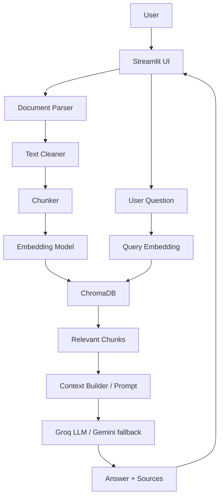
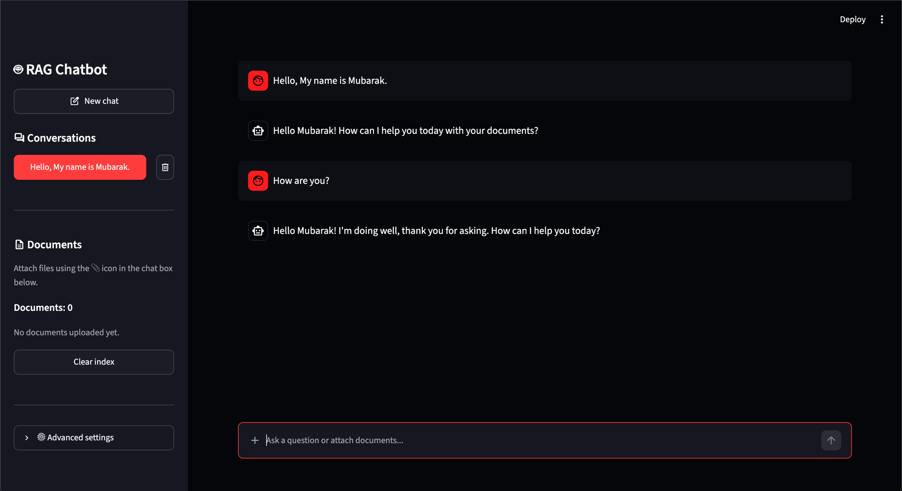

# ALLY AI

ALLY AI is a document-grounded RAG (Retrieval-Augmented Generation) chatbot built with
Python, Streamlit, ChromaDB, local embeddings, and Groq (with Google
Gemini as a fallback).

## Table of Contents

- [Overview](#overview)
- [Features](#features)
- [Architecture](#architecture)
- [Tech Stack](#tech-stack)
- [Project Structure](#project-structure)
- [Installation](#installation)
- [Environment Variables](#environment-variables)
- [Running the Application](#running-the-application)
- [How RAG Works](#how-rag-works)
- [Example Usage](#example-usage)
- [Screenshots](#screenshots)
- [Testing](#testing)
- [Future Improvements](#future-improvements)

## Overview

Attach PDF, DOCX, TXT, or Markdown documents — or video/audio files, which
are transcribed — with the **Attach** button above the chat box, watch them
being indexed, and ask questions about them. The
assistant answers from your uploaded documents whenever they contain the
answer — it retrieves the most relevant chunks, sends just that context to
the LLM, and cites the source file (and page, when available). If nothing
relevant is found, it answers from general knowledge and labels it as such;
with strict document mode on, it says so instead of guessing.

Conversations are saved to disk and listed in the sidebar, so you can pick
up an earlier conversation later — even after restarting the app.

## Features

**Document handling**
- Multi-document upload from the **Attach** button above the chat box: a
  dialog shows each file's progress (reading text, reading charts, embedding
  420 of 1,194 passages, ...), then "GEP-Jun-2026.pdf is ready: 200 pages,
  1,676 passages, 101 charts measured" and a note in the chat
- Video/audio support (MP4, MOV, WebM, MKV, AVI, MP3, WAV, M4A, OGG, FLAC):
  speech is transcribed locally with `faster-whisper` into `[mm:ss]`-timestamped
  text, plus an info page (duration, resolution, frame rate, language), so you
  can ask what was said and when. On-screen visuals are not analysed.
- Voice questions: tap 🎤 in the chat box to ask by speaking — the recording
  is transcribed locally and answered like a typed question
- Charts, tables and footnotes in short visual PDFs (up to
  `VISUAL_READING_MAX_PAGES` pages): a vision model transcribes each page's
  charts, tables and call-outs (cached once read), and every footnote is
  attached to the page that references it; a retrieved passage with a
  footnote marker (`[1]`) brings that note along. Longer PDFs: only pages
  with a chart that can't be measured (a pasted picture) are read, up to
  `VISUAL_CHART_PAGES`
- Chart questions ("…from the chart", "figure 3.1"): bar, grouped-bar and
  stacked-bar charts drawn as vector shapes are measured from the PDF's own
  drawing (axis ticks → scale, legend colours → series, labels → categories;
  about ±1% of the axis range, free and local) and indexed as passages. The
  answer is read from the chart page: Gemini sees the page image with the
  measured values, and every number says where it came from: printed values
  exactly, "≈ 51.7% (measured from the chart, page 110)", or "≈ 30% (estimated
  from the chart image, page 110)" for charts that are pictures, line charts
  or candlesticks. Without Gemini, the measured values are answered from by
  the text model. Page numbers are the PDF's, and "📊 Chart read: …" under the
  answer names the pages used
- Robust text extraction with graceful handling of empty/corrupted files
- Text cleaning (whitespace, broken line breaks, extraction artifacts)
- Structure-aware chunking (paragraph/sentence-boundary-first splitting)
- Section-aware long reports: chapters, sections and boxes are detected from
  bookmarks and running headers, every chunk is labelled with its section, and
  a question that names a section ("according to the executive summary…",
  "South Asia") searches only there
- Duplicate-upload protection (same document isn't re-indexed twice)

**Retrieval & answers**
- Local embeddings (`sentence-transformers`, no external embedding API)
- Persistent ChromaDB vector store (no re-indexing after a restart)
- Query rewriting before search: one short LLM call fixes typos ("wat is my
  vitamn d") and turns follow-ups ("and my cholesterol?") into standalone
  queries; falls back to your exact words if it fails, and is skipped (no
  extra call or tokens) when every word is a common word or appears in your
  documents and the question is not a follow-up
- Semantic retrieval with a configurable similarity threshold; summary requests
  ("summarize this video", "what is the report about?") fetch more chunks and
  skip the threshold so the whole document is covered
- **Auto mode** (agentic RAG): the LLM gets a document-search tool and decides
  whether to search, how many times and with what wording — e.g. one search per
  part of a comparison — then answers with citations, like ChatGPT/Claude.
  Each answer shows what was searched. Falls back to the standard flow on failure
- **Auto model**: simple questions go to a fast Groq model, complex ones
  (comparisons, explanations, multi-part) to a stronger one
- Context-grounded answer generation via Groq, falling back to Gemini
  (picking a Gemini model in the model picker sends it to Gemini first)
- Source citations (filename + page number when available)
- Every answer is labeled: 📄 from your documents or 🌐 general knowledge
- Strict document mode (off by default) — refuses to answer beyond the docs
- Model picker next to the chat box and a temperature slider in settings
- Small talk — greetings, self-introductions ("hi, my name is..."), and
  conversational-recall questions ("what's my name?", "what did I say?")
  always get a normal reply, even in strict mode. Strict mode only guards
  *document* facts, not the conversation itself
- Retrieval transparency / debug mode (see the retrieved chunks + scores)

**Conversation**
- Conversational chat with history — remembers earlier turns for
  continuity (e.g. your name, follow-up references) alongside document
  grounding
- Persistent conversation history, ChatGPT-style — every conversation is
  saved to disk, listed in the sidebar with an auto-generated title, and
  can be reopened later (including after a restart)
- New chat, delete conversation, clear document index

**Reliability**
- Friendly error handling throughout — no raw stack traces in the UI

## Architecture



Conversations are a separate concern from the RAG flow above: each chat
session is saved as its own JSON file (see [`conversation_service.py`](app/services/conversation_service.py))
and reloaded into the UI when you pick it from the sidebar.

## Tech Stack

| Concern | Choice |
|---|---|
| Language | Python 3.11+ |
| UI | Streamlit |
| Document parsing | `pypdf`, `python-docx`, built-in text/Markdown handling |
| Video/audio | `faster-whisper` (local speech-to-text, run in its own process), `av` for metadata |
| Chunking | LangChain's `RecursiveCharacterTextSplitter` |
| Embeddings | `sentence-transformers/all-MiniLM-L6-v2` (configurable) |
| Vector store | ChromaDB (persistent, local) |
| LLM | Groq (`requests`, OpenAI-compatible API), Google Gemini fallback (`google-genai`) |
| Conversation storage | Plain JSON files on disk |
| Config | `.env` via `python-dotenv` |

## Project Structure

```
app/
├── main.py                     # Streamlit entry point / orchestration
├── config/
│   └── settings.py             # Env-driven configuration
├── ui/
│   ├── sidebar.py               # Conversation history, document list, and settings UI
│   ├── chat.py                  # Chat input (incl. file attach), sources, debug view
│   └── components.py            # Small reusable UI pieces
├── rag/
│   ├── document_loader.py       # PDF/DOCX/TXT/MD -> DocumentPage
│   ├── media_transcriber.py     # Video/audio -> info page + timestamped transcript
│   ├── transcribe_worker.py     # Whisper speech-to-text, run as a separate process
│   ├── text_cleaner.py          # Whitespace/artifact cleanup
│   ├── chunker.py                # Text -> Chunk (with metadata)
│   ├── embeddings.py             # Cached sentence-transformers wrapper
│   ├── vector_store.py           # Persistent ChromaDB wrapper
│   ├── retriever.py              # Question -> relevant chunks
│   ├── keyword_search.py         # BM25 keyword search, merged with vectors (hybrid)
│   ├── query_decomposer.py       # Multi-part questions -> sub-questions
│   ├── query_router.py           # LLM routing of questions to sections (optional)
│   ├── layout_tables.py          # Tables rebuilt from header bars + word positions
│   ├── prompt.py                 # RAG prompt template
│   ├── generator.py              # Groq/Gemini answer generation (+ Groq tool calling)
│   ├── agent.py                  # Auto mode: LLM-driven search with a tool
│   ├── model_router.py           # "auto" model: fast vs strong per question
│   ├── reranker.py               # Cross-encoder reranking of retrieved chunks
│   └── small_talk.py             # Greeting/intro/recall detection
└── services/
    ├── document_service.py      # Parse+clean orchestration, per-file errors
    ├── rag_service.py           # Full pipeline: index + ask
    └── conversation_service.py  # Save/load/list/delete past conversations
data/
├── uploads/                     # Uploaded documents (gitignored)
├── chroma/                      # Persistent vector store (gitignored)
└── conversations/                # Saved chat history, one JSON per conversation (gitignored)
tests/                            # Unit & integration tests (one file per module above)
```

## Installation

### 1. Create a virtual environment

```bash
python -m venv .venv
```

**Activate it:**

macOS/Linux:

```bash
source .venv/bin/activate
```

Windows:

```bash
.venv\Scripts\activate
```

### 2. Install dependencies

```bash
pip install -r requirements.txt
```

> **Note (Intel macOS):** PyTorch stopped publishing x86_64 macOS wheels
> after 2.2.2. `requirements.txt` pins `torch==2.2.2` plus compatible
> `numpy`/`transformers`/`sentence-transformers` versions for that
> platform. On other platforms these pins still work but you may use
> newer versions if you prefer.

### 3. Configure environment variables

```bash
cp .env.example .env
```

Edit `.env` and set `GROQ_API_KEY` (get one at
[console.groq.com/keys](https://console.groq.com/keys)) and/or `GEMINI_API_KEY`
(get one at [Google AI Studio](https://aistudio.google.com/app/apikey)).
At least one is needed for answers. Never commit
your real `.env` file — it's already excluded via `.gitignore`.

> **Free tier note:** Google's free tier caps requests per day per project
> for a given model (check current limits in AI Studio). If you hit a
> `429`/quota error while testing, the app shows a friendly "unable to
> generate an answer" message rather than crashing — just wait for the
> quota to reset or use a paid key.

## Environment Variables

See [`.env.example`](.env.example) for the full file with defaults:

| Variable | Purpose | Default |
|---|---|---|
| `GROQ_API_KEY` | Groq API key (primary provider) | _(none)_ |
| `GROQ_MODEL` | Groq model ID, or `auto` (simple questions → fast model, complex → strong) | `auto` |
| `GROQ_FAST_MODEL` / `GROQ_STRONG_MODEL` | Models `auto` chooses between | `openai/gpt-oss-20b` / `openai/gpt-oss-120b` |
| `GEMINI_API_KEY` | Gemini API key (fallback provider) | _(none)_ |
| `GEMINI_MODEL` | Gemini model name | `gemini-3.5-flash-lite` |
| `GEMINI_TEMPERATURE` | Sampling temperature (0.0-2.0); lower = more literal/consistent | `0.2` |
| `OPENROUTER_API_KEY` | OpenRouter key, used to read charts/tables from page images | _(none: text and footnotes only)_ |
| `VISION_MODEL` | OpenRouter vision models (comma-separated, tried in order) | free models, see `.env.example` |
| `VISUAL_READING_MAX_PAGES` | Read every page image for PDFs up to this many pages (`0` = off) | `30` |
| `VISUAL_CHART_PAGES` | Longer PDFs: read only this many pages with an unmeasurable chart (`0` = off) | `40` |
| `INDEX_MEASURED_CHARTS` | Index bar charts measured from the PDF drawing as passages | `true` |
| `CHART_READING` | Answer chart questions from the chart page (measured values + page image for Gemini) | `true` |
| `CHART_MODEL` | Gemini model that looks at chart pages | `GEMINI_MODEL` |
| `VISION_CACHE_DIR` | Where vision replies are cached | `data/vision_cache` |
| `MODEL_DEVICE` | Device for local models: `cpu`, `cuda`, `mps` or `auto` (`mps` was 4-10× slower on Intel Macs) | `cpu` |
| `EMBEDDING_MODEL` | sentence-transformers model name | `sentence-transformers/all-MiniLM-L6-v2` |
| `EMBEDDING_QUERY_PREFIX` | Instruction prepended to queries (needed by some models, e.g. BGE) | _(empty)_ |
| `WHISPER_MODEL` | faster-whisper model for video/audio (`tiny`/`base`/`small`/`medium`) | `base` |
| `CHROMA_PERSIST_DIR` | Where the vector store is saved | `data/chroma` |
| `CHROMA_COLLECTION_NAME` | ChromaDB collection name | `rag_documents` |
| `CHUNK_SIZE` | Characters per chunk | `800` |
| `CHUNK_OVERLAP` | Character overlap between chunks | `150` |
| `CHUNK_STRATEGY` | `recursive` (paragraph/line/sentence/word boundaries) or `sentence` (whole sentences, packed across pages of a section) | `recursive` |
| `CHUNK_UNIT` | What chunk size/overlap count: `chars` or `tokens` (embedding model tokens) | `chars` |
| `TOP_K` | Number of chunks retrieved per question | `5` |
| `SIMILARITY_THRESHOLD` | Minimum cosine similarity ([-1, 1]) for a chunk to count as relevant | `0.2` |
| `RERANKER_MODEL` | Cross-encoder that reorders retrieved candidates (empty = off) | `cross-encoder/ms-marco-MiniLM-L-6-v2` |
| `RERANK_CANDIDATES` | Candidates fetched for the reranker to choose `TOP_K` from | `20` |
| `RERANK_MIN_SCORE` | Drop passages the reranker scores below this (empty = off) | _(empty)_ |
| `RERANK_RELATIVE_MARGIN` | Context compression: drop passages scored more than this below the best one (`off` = disabled) | `5` |
| `HYBRID_SEARCH` | Also rank chunks by exact words (BM25) and merge with the embedding search | `true` |
| `KEYWORD_CANDIDATES` | BM25 candidates merged into each search | `20` |
| `SECTION_AWARE` | Detect sections in structured PDFs; search only sections a question names | `true` |
| `STRUCTURE_SOURCE` | Section headings from `auto` (bookmarks, else font sizes), `bookmarks` or `fonts` | `auto` |
| `QUERY_ROUTING` | Route questions to sections by `rules`, or `llm` (rules first, then one LLM call) | `rules` |
| `LAYOUT_TABLES` | Rebuild tables from page layout (no vision): `auto`, `on` or `off` | `auto` |
| `STRICT_DOCUMENT_MODE` | Refuse to answer beyond the documents | `false` |
| `QUERY_REWRITING` | Rewrite questions with the LLM before searching (typos, follow-ups) | `true` |
| `QUERY_DECOMPOSITION` | Split comparison/multi-part questions into sub-questions, each searched | `true` |
| `AGENT_MODE` | Auto mode: the LLM decides whether/how often to search (needs Groq) | `true` |
| `AGENT_MAX_SEARCHES` | Most searches auto mode may run per question | `3` |
| `MODEL_PRICES` | Extra or changed paid-tier prices for cost estimates, `model=input/output` USD per 1M tokens | _(built-in table)_ |

## Running the Application

```bash
streamlit run app/main.py
```

Opens at `http://localhost:8501`.

1. Click **Attach** above the chat box, pick documents and press **Upload**.
   The dialog shows each file's progress; press **Start asking** when it's ready.
2. Ask questions in the chat box.
3. Use **New chat** to start a fresh conversation, or click any past
   conversation in the sidebar to reopen it.
4. Tap 🎤 in the chat box to ask a question by voice instead of typing.
5. Pick a model from the dropdown next to the chat box.
6. Open **⚙️ Advanced settings** to toggle strict document mode, the
   retrieval debug view, or adjust the temperature.
7. Open **Use case results** (top navigation) to compare Naive and Advanced
   RAG on each hands-on use case. In each use case, pick one of its three
   main questions and click **Apply**: Naive RAG (similarity search only) and
   Advanced RAG answer it side by side, with PASS/FAIL, the passages and
   steps, faithfulness/relevance/context scores (LLM-judge estimates, marked
   as such), what each technique (rewriting, decomposition, keyword search,
   reranking) did on its own, latency, token usage and estimated cost at
   paid-tier prices. Latency, tokens and cost are shown as the cost of the
   extra steps, and the overall verdict is about the answer only.
   `python -m evaluation.compare` saves the comparison for every question
   (resuming if Groq's quota stops it), so it shows without an API call.

## How RAG Works

1. **Upload** — you attach PDF/DOCX/TXT/MD or video/audio files with the
   **Attach** button.
2. **Parse** — each format is converted into plain text, preserving the
   source filename and page number (PDF only). Video/audio is transcribed,
   each line prefixed with its `[mm:ss]` timestamp.
3. **Clean** — whitespace and extraction artifacts are normalized.
4. **Chunk** — text is split into ~800-character pieces (150-character
   overlap), preferring paragraph/sentence boundaries.
5. **Embed** — each chunk is converted into a vector using a local
   sentence-transformers model.
6. **Store** — chunks + vectors + metadata are saved in a persistent
   ChromaDB collection (survives app restarts).
7. **Ask** — your question is first rewritten by the LLM when needed (typos
   fixed, follow-ups made standalone), then embedded the same way and compared against
   stored chunks to find the most similar ones.
8. **Generate** — only the retrieved chunks (not your whole document
   collection) are sent to the LLM, along with recent conversation history
   for continuity, with instructions to answer document questions using
   only that context.
9. **Answer + Sources** — the response is shown along with which
   document(s)/page(s) it came from. If nothing relevant was found, the
   answer comes from general knowledge and is labeled that way — or, with
   strict mode on, you get a clear "not found" message instead.

## Example Usage

- "What is the annual leave policy?"
- "Summarize the key points of section 3."
- "Does the handbook mention remote work?"
- "Hi, my name is Alex" → "What's my name?" — the assistant remembers
  this from the conversation, without needing it in any document.
- "What happens after a document doesn't contain a fact?" → the
  assistant tells you it couldn't find that information, rather than
  making something up.

## Screenshots

**Conversational memory** — the assistant remembers what you told it
earlier in the same conversation ("My name is Mubarak" → later, "How are
you?" gets answered by name), while the sidebar shows the auto-titled,
reopenable conversation history, ChatGPT-style:



## Testing

```bash
pytest
```

Tests cover document parsing (including video/audio transcription, with
the Whisper model faked), text cleaning, chunking (including
metadata/determinism), embeddings, the vector store, retrieval, prompt
construction, small-talk detection, conversation persistence, and a full
pipeline integration test. The Groq and Gemini APIs are mocked throughout, so
`pytest` never requires a real API key.

## Future Improvements

- OCR support for scanned/image-only PDFs
- Streaming responses
- Authentication
- Cloud-hosted vector database option
- Multilingual document support

## Quick Start

```bash
cd /Users/mubarak/Desktop/AI_Training/AI-Training-Project
source .venv/bin/activate
streamlit run app/main.py
```
